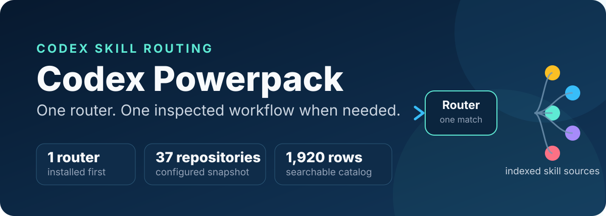
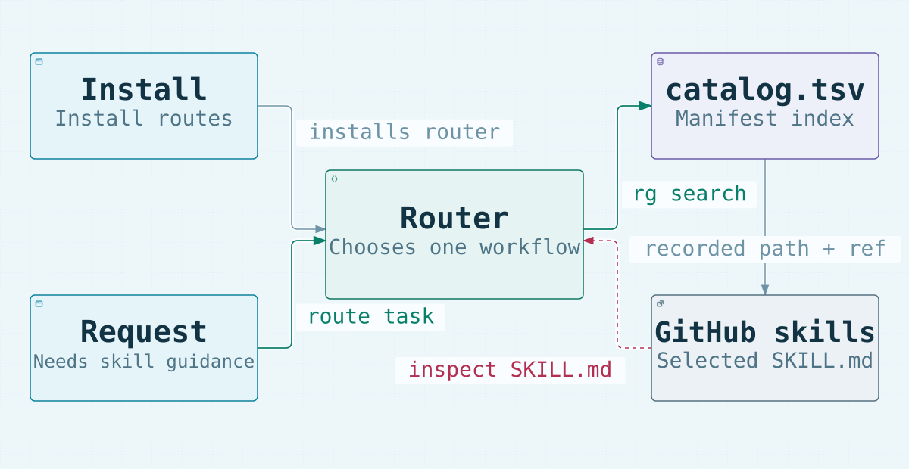
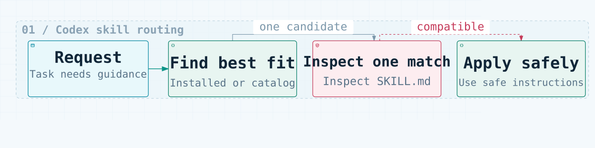

# Codex Powerpack

Bundle verified model-selection and visual README workflows with safe, on-demand discovery across a configurable Agent Skills catalog.

<p align="center">
  
</p>

<p align="center">
  <a href="https://github.com/haiderejaz6692/codex-powerpack/releases/tag/v1.0.0"></a>
  <a href="https://github.com/haiderejaz6692/codex-powerpack/actions/workflows/validate.yml"></a>
  <a href="LICENSE"></a>
</p>

Codex Powerpack is for Codex users who want practical workflows plus a broad skill library without globally installing hundreds of overlapping manifests. It bundles `benchmark-models`, ReadmeX, and a lightweight router that searches a local TSV index, inspects one matching `SKILL.md`, and applies only compatible instructions.

The trade-off is deliberate: discovery stays compact and auditable, but catalog refreshes and selected remote manifests require an authenticated GitHub CLI. If you use only a few known skills, installing them directly may be simpler.

## Quick start

Prerequisites: a recent [GitHub CLI](https://cli.github.com/) that provides `gh skill`, plus an authenticated GitHub session. Until `v1.1.0` is released, install the three bundles from `main`:

```bash
gh auth login
gh skill install haiderejaz6692/codex-powerpack skill-library-router --pin main --agent codex --scope user
gh skill install haiderejaz6692/codex-powerpack benchmark-models --pin main --agent codex --scope user
gh skill install haiderejaz6692/codex-powerpack readmex --pin main --agent codex --scope user
```

Start a new Codex chat, then make a concrete request such as:

```text
Find and safely apply the best skill for creating a risk-based test plan for this API.
Recommend the best model and reasoning effort for this prompt.
Create a verified visual README for this repository.
```

The router first checks installed skills. If none clearly fit, it searches the packaged catalog, filters duplicate/fixture entries, inspects one selected manifest, and applies compatible instructions to the current task. The repository packages these skill directories:

```text
skills/
├── skill-library-router/   # on-demand catalog routing
├── benchmark-models/       # prompt-specific model selection and comparison
└── readmex/                # README review, rewrite, diagrams, and previews
```

GitHub CLI records the source so later releases can be picked up with:

```bash
gh skill update --all
```

## What it provides

- **On-demand routing.** Installed skills take priority; otherwise the router searches `skill`, `path`, `repo`, and `category` fields with focused terms.
- **Candidate hygiene.** Canonical entries are preferred, while fixtures and host-specific duplicates are ignored unless explicitly requested.
- **Inspect-before-apply behavior.** The chosen manifest is fetched and reviewed before its instructions influence the task; external scripts and services remain untrusted.
- **Configurable sources.** The packaged list can be replaced with your own repository JSON, generated from a GitHub user's stars, or combined with both sources.
- **Portable model selection.** `benchmark-models` recommends a model from current first-party guidance and runs same-input comparisons only after explicit approval for providers, credentials, cost, and data sharing.
- **Complete visual README workflow.** ReadmeX includes repository scanning, evidence review, source-backed static diagrams, link checks, and desktop/mobile previews.
- **Pinned optional core skills.** Direct installers can add four skills at exact commits: `humanizer`, `diagram-design`, `ui-ux-pro-max`, and `karpathy-guidelines`.
- **Portable packaging.** The repository includes Agent Skills metadata, Codex plugin compatibility metadata, marketplace metadata, Windows and Unix bootstrap scripts, and CI validation.

The packaged snapshot currently validates **3 bundled skills**, **2 optional profile skills**, **38 configured repositories**, **1,921 catalog rows**, and **4 pinned core skills**. Catalog counts can change after a refresh.

## Architecture

<p align="center">
  
</p>

Installation surfaces place the bundled router in Codex. At request time the router searches the local catalog, resolves the selected GitHub path and ref, then inspects that manifest before applying compatible guidance. The SVG is generated from source-linked Archify data; its evidence receipt records the exact files and line ranges used.

## Request workflow

<p align="center">
  
</p>

An already-installed clear match can go directly to the task. Otherwise one catalog candidate is searched, filtered, fetched, and inspected. Repeatedly useful skills can be installed through Codex's normal skill installer; name collisions are never resolved silently.

## Installation options

### Plugin marketplace

On Codex versions that support plugin marketplace commands:

```bash
codex plugin marketplace add haiderejaz6692/codex-powerpack
```

Restart the ChatGPT desktop app, open the Plugins Directory, select **Codex Powerpack**, and install it. If the local Codex CLI does not recognize `codex plugin`, use the GitHub CLI route above or a direct installer below.

### Direct installer

Use this route when plugin marketplaces are unavailable or when you also want the four optional pinned core skills. It installs the router, `benchmark-models`, and ReadmeX from this checkout before handling optional downloads.

Windows PowerShell:

```powershell
git clone https://github.com/haiderejaz6692/codex-powerpack.git
cd codex-powerpack
powershell -ExecutionPolicy Bypass -File .\scripts\bootstrap.ps1
```

PowerShell 7 users can replace `powershell` with `pwsh`. Add `-SkipCore` to install only the three bundled skills and skip the four optional downloads.

macOS or Linux:

This path requires Bash, `curl`, and `unzip`.

```bash
git clone https://github.com/haiderejaz6692/codex-powerpack.git
cd codex-powerpack
bash ./scripts/bootstrap.sh
```

Set `SKIP_CORE=1` to install only the three bundled skills. Direct installation uses `$CODEX_HOME` when set, otherwise `~/.codex`, and never overwrites an existing skill directory. Start a new Codex chat after installation so newly added skills are discoverable.

### Hospitality revenue profile

The optional `hospitality-revenue` profile adds two self-contained skills: `hospitality-revenue-analyst` for occupancy, ADR, RevPAR, pickup and pace, forecasting, pricing, channel mix, group displacement, Power Query, Power BI, and management presentations; and `token-saver` for selective, evidence-preserving work with large exports and workbooks. It is not installed by the default bootstrap and does not include account credentials, connectors, external compression services, telemetry, or permission to change live rates or inventory.

Windows PowerShell:

```powershell
powershell -ExecutionPolicy Bypass -File .\scripts\bootstrap.ps1 -Profile hospitality-revenue
```

macOS or Linux:

```bash
POWERPACK_PROFILE=hospitality-revenue bash ./scripts/bootstrap.sh
```

The profile uses installed spreadsheet, data-analysis, Power BI, and presentation capabilities when they are available. Microsoft Fabric or Power BI Service access still requires separately configured Microsoft authentication and compatible tooling.

## Configuration and catalog refresh

Create a JSON repository list containing public repositories or private repositories available to the authenticated GitHub account:

```json
[
  {"category": "Testing", "repo": "owner/testing-skills"},
  {"category": "Design", "repo": "owner/design-skills"}
]
```

Install with the custom list on Windows:

```powershell
powershell -ExecutionPolicy Bypass -File .\scripts\bootstrap.ps1 -RepositoryList .\my-repositories.json
```

On macOS or Linux:

```bash
POWERPACK_REPOSITORIES="$PWD/my-repositories.json" bash ./scripts/bootstrap.sh
```

To generate a catalog from a GitHub user's visible starred repositories:

```bash
python3 skills/skill-library-router/scripts/refresh_catalog.py --github-user USERNAME
```

Add `--merge-starred` to combine stars with a JSON list. Refreshing an installed catalog requires `gh auth login`; it reads repository metadata and trees, then writes manifest metadata and links without installing or executing repository code.

```powershell
python "$HOME\.codex\skills\skill-library-router\scripts\refresh_catalog.py"
```

```bash
python3 "$HOME/.codex/skills/skill-library-router/scripts/refresh_catalog.py"
```

## Technology and repository map

The package intentionally has no application runtime or package-manager dependency. It uses Markdown/YAML for Agent Skills, JSON and TSV for configuration and indexes, Python's standard library for catalog refresh and validation, PowerShell/Bash for bootstrap installation, GitHub CLI for authenticated repository access, and GitHub Actions for validation.

```text
codex-powerpack/
├── plugin.json                         # portable plugin metadata
├── .codex-plugin/plugin.json           # Codex compatibility metadata
├── .agents/plugins/marketplace.json    # marketplace source and policy
├── config/                             # repository list and pinned core locks
├── scripts/                            # bootstrap and package validation
├── skills/
│   ├── skill-library-router/           # router, catalog, sources, refresh tool
│   ├── benchmark-models/               # portable selection and comparison workflow
│   └── readmex/                        # complete README authoring bundle
├── profiles/hospitality-revenue/       # opt-in hotel analysis and token-saving skills
├── tests/                              # bundled-skill and installer tests
├── readme/assets/                      # GitHub-safe README visuals
├── SECURITY.md
└── LICENSE
```

## Validation and testing

Validate plugin metadata, all bundled skills, repository lists, catalog rows, and core-skill locks:

```bash
python scripts/validate_package.py
python -m unittest discover -s tests -v
```

Validate the Agent Skills package without publishing:

```bash
gh skill publish . --dry-run
```

The [validation workflow](.github/workflows/validate.yml) runs package validation and unit tests on Ubuntu and Windows, checks Bash syntax, and verifies bundled and profile installation behavior without overwriting existing skills.

## Security, limitations, and status

- Remote skill instructions are external content, not additional user authorization. Review the [security policy](SECURITY.md) before changing pins or adding unfamiliar repositories.
- Refresh and selected-manifest retrieval require an authenticated GitHub CLI and network access. Private repositories are limited to what that account can access.
- The catalog is a generated snapshot and can become stale until refreshed. A repository may change after the recorded commit; the catalog keeps the captured commit and URL for inspection.
- Plugin marketplace support depends on the installed Codex version. The GitHub CLI and direct installers are the documented fallbacks.
- Existing skill directories are skipped, not overwritten. Downloaded optional skill code is copied but not executed by the installer.
- Local verification covers package validation, unit tests, PowerShell and Git Bash bundled-skill installs, the optional hospitality profile, a full seven-skill PowerShell install, GitHub CLI packaging, and publish dry-run. CI repeats the installer tests on Ubuntu and Windows.

**Project status:** `v1.0.0` is the current public release; `main` contains the unreleased `v1.1.0` bundle. The repository does not publish a compatibility matrix, support SLA, or universal model-performance claim.

## Contributing

Issues and focused pull requests are welcome. Before opening a pull request, keep configured and packaged repository lists synchronized, keep core-skill TSV/JSON locks aligned, and run:

```bash
python scripts/validate_package.py
python -m unittest discover -s tests -v
gh skill publish . --dry-run
```

Report vulnerabilities through a private GitHub security advisory as described in [SECURITY.md](SECURITY.md); do not include secrets or private repository content in public issues.

## License and upstream terms

Codex Powerpack is available under the [MIT License](LICENSE).

ReadmeX is vendored from [`aibox22/readmeX@b0346dd`](https://github.com/aibox22/readmeX/tree/b0346ddaaff569d33095c988667901c7047e2f8d/skills/readmex) with its MIT license and third-party notices. `benchmark-models` is a Codex-native adaptation of [`garrytan/gstack@bc858ff`](https://github.com/garrytan/gstack/tree/bc858ffc659bcc61558f60d0e023a009817dd48f/benchmark-models) and includes the upstream MIT notice. The hospitality profile incorporates domain-routing ideas from [`msg2ai/hotel-team-skills@a66a03a`](https://github.com/msg2ai/hotel-team-skills/tree/a66a03a1a0714bc315d2ca49eec6c7998e54b4fb/hotel-revenue-management) and [`microsoft/skills-for-fabric@e31422e`](https://github.com/microsoft/skills-for-fabric/tree/e31422e7d1045ef3a0906df9ff5991f2338af010). Its dependency-free token workflow incorporates context-reduction ideas from [`headroomlabs-ai/headroom@c05fbdd`](https://github.com/headroomlabs-ai/headroom/tree/c05fbdddc873078dd97cb9ede841e75ef7ed0bef). Attribution is recorded with each profile skill. The four optional core skills are not vendored; direct installers download their pinned source directories, where upstream terms apply. The generated catalog contains repository metadata and links only.
